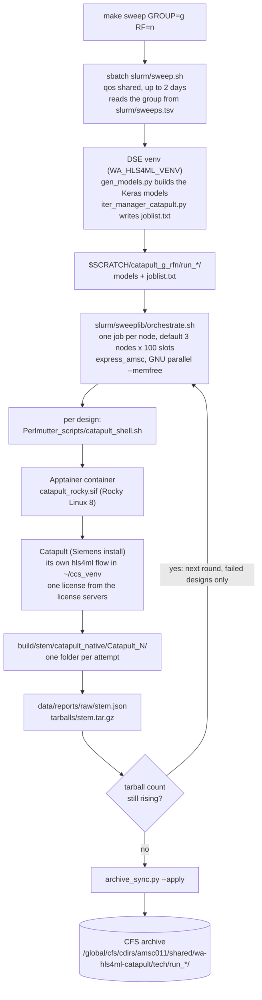
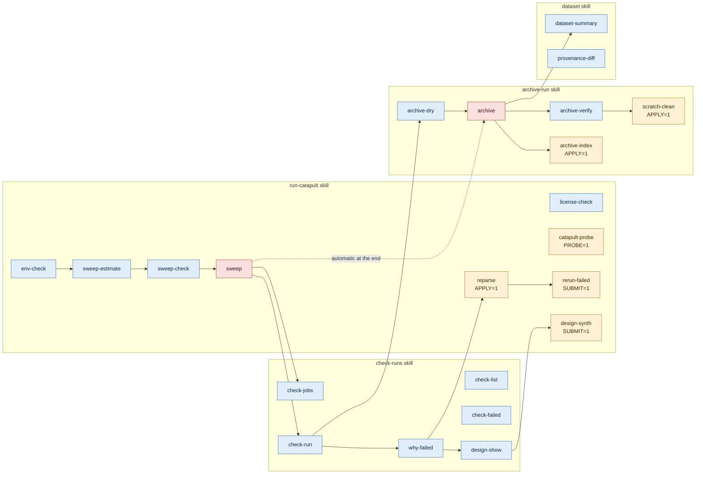

# Skills and make targets

The Catapult sweep work on Perlmutter is driven by `make` targets in the repo root
(`make help` lists them). The four skills in this folder are what an agent (Claude
Code) reads before using those targets. They add no commands of their own. Each one
says which targets fit a question, what the output means, and which steps need a
person's yes first. A person running `make` and an agent running it get the same
answer.

| Skill | Answers | Targets it uses |
|---|---|---|
| [`run-catapult`](run-catapult/SKILL.md) | Does Catapult work here? Plan, check and submit a sweep. Repair a run. | `env-check`, `license-check`, `catapult-probe`, `sweep-estimate`, `sweep-check`, `sweep`, `reparse`, `rerun-failed`, `design-synth` |
| [`check-runs`](check-runs/SKILL.md) | How are jobs and runs doing? What failed and why? What did one design do? | `check-jobs`, `check-list`, `check-run`, `check-failed`, `why-failed`, `design-show` |
| [`archive-run`](archive-run/SKILL.md) | Copy a run to the shared archive, prove the copy, free scratch, index the archive README. | `archive-dry`, `archive`, `archive-verify`, `scratch-clean`, `archive-index` |
| [`dataset`](dataset/SKILL.md) | How big is the dataset? How many good designs per tech, group or RF? Do the docs match? Which runs are training data? | `dataset-summary`, `provenance-diff` (and `check-list`, `check-run`, `archive-index` from the others) |

Two general skills complete the set. They are not in this repo: `perlmutter` (QOS,
node types, scratch, allocations) and `slurm` (sbatch, sacct, job arrays). They come
from the genesis-skills repository and are installed in `~/.claude/skills/`.

## How a sweep runs

What happens after `make sweep`, and which Python environment, container and
storage each step uses:



Scratch keeps everything, including every Catapult attempt under `build/`, until the
purge (files unread for 8 weeks) or `make scratch-clean`. The archive keeps one
report and one project tarball per design.

## How skills and targets fit together

Each box is a skill; inside it are the make targets it covers. Arrows follow a run
from start to archive. Colors show what a target changes: blue only reads, amber
does nothing without its flag (`PROBE=1`, `SUBMIT=1`, `APPLY=1`), red acts every
time it runs.



`check-list` and `check-run` also serve the dataset skill for one run, and
`archive-index` for the archive README.

## Every target

What a target can change decides how freely it is run:

- **read**: reads files, Slurm or the archive; changes nothing. Run any time.
- **plan / flag**: prints a plan; changes things only with its flag (`PROBE=1`,
  `SUBMIT=1`, `APPLY=1`). Show the plan, get a yes, then add the flag.
- **acts**: changes something every time it runs, so a dry run comes first.

| Target | Skill | Kind | What it changes | Needs | Time (tested 2026-11-17) |
|---|---|---|---|---|---|
| `env-check` | run-catapult | read | nothing | | ~20 s |
| `license-check` | run-catapult | read | nothing | `LMUTIL=` for feature lists | seconds |
| `catapult-probe` | run-catapult | plan / `PROBE=1` | starts Catapult once: **one license**, files in `$SCRATCH/catapult_probe` | Catapult install | seconds |
| `sweep-estimate` | run-catapult | read | nothing | past runs on scratch for timings | seconds |
| `sweep-check` | run-catapult | read | nothing (`sbatch --test-only`) | DSE venv | seconds |
| `sweep` | run-catapult | **acts** | submits the sweep: **nodes and up to 300 licenses**, writes `$SCRATCH/catapult_<group>_rf<N>/`, copies results into the archive at the end | DSE venv, `sweep-check` first | hours to days |
| `reparse` | run-catapult | plan / `APPLY=1` | rewrites reports and tarballs on scratch, old ones to `*_stale_<date>/` | NERSC Python (no venv) | minutes |
| `rerun-failed` | run-catapult | plan / `SUBMIT=1` | submits one job for designs with no QoR; old files to `*_stale_<tag>/` | DSE venv, `reparse` first | job-length |
| `design-synth` | run-catapult | plan / `SUBMIT=1` | submits one design into a new `$SCRATCH/catapult_debug/run_*` | DSE venv | job-length |
| `check-jobs` | check-runs | read | nothing | | seconds |
| `check-list` | check-runs | read | nothing | | seconds |
| `check-run` | check-runs | read | nothing | | ~1 min for a 5k-design archive run |
| `check-failed` | check-runs | read | nothing | scratch run folder | ~30 s for 5k designs |
| `why-failed` | check-runs | read | nothing | scratch run folder | ~2 min (`FAST=1`) to ~3 min for 5k designs |
| `design-show` | check-runs | read | nothing | | instant |
| `archive-dry` | archive-run | read | nothing | scratch run folder | seconds |
| `archive` | archive-run | **acts** | copies new and repaired designs **into the shared archive**; backs up the reports it replaces; never deletes | `archive-dry` first, no job writing the run | minutes |
| `archive-verify` | archive-run | read | nothing | scratch run folder | ~20 s (`ALL=1`: MD5 of every tarball, longer) |
| `scratch-clean` | archive-run | plan / `APPLY=1` | **deletes the scratch run folder**, including `build/` (every Catapult attempt; the archive does not keep it) | passes `archive-verify` itself; refuses otherwise | seconds to refuse; ~10 min to measure a run with 2M files in `build/` |
| `archive-index` | archive-run | plan / `APPLY=1` | appends missing runs to the **shared archive README**, after a backup | | instant |
| `dataset-summary` | dataset | read | its cache, `~/.cache/wa-hls4ml/run_counts.json` | | ~10 s with `FAST=1`; seconds from cache, tens of minutes without |
| `provenance-diff` | dataset | read | its cache (same file) | | seconds from cache |

`make sweep` and `make archive` are the only targets that act without a flag.
`make scratch-clean APPLY=1` is the only one that deletes.

## Which Python

- Most targets use the system `python3` (3.6) and need no venv. That includes all of
  check-runs, archive-run and dataset, so they work even when the venv is broken.
- `reparse` and `sweep-estimate` use NERSC's Python (`NERSC_PY` in the Makefile).
- `sweep`, `sweep-check`, `rerun-failed` and `design-synth` use the **DSE venv**
  (`WA_HLS4ML_VENV`, TensorFlow 2.11, QKeras, hls4ml 0.8.1, ray, from
  `requirements.venv.txt`). That venv builds the models and the job lists.
- Catapult itself uses a different venv, `~/ccs_venv`, created by Siemens's
  `create_env.sh`. Catapult picks it up by itself. It cannot replace the DSE venv
  (no ray, TensorFlow 2.15).

## A run from start to archive

```
make env-check                                  # tool chain OK?
make sweep-estimate GROUP=<g> RF=<n>            # how big, how long
make sweep-check    GROUP=<g> RF=<n> [options]  # plan + sbatch --test-only
make sweep          GROUP=<g> RF=<n> [options]  # after a yes
make check-jobs; make check-run RUN=<run_dir>   # while and after it runs
make why-failed RUN=<run_dir>                   # if designs failed
make reparse RUN=<run_dir>  [APPLY=1]           # QoR sitting in a retry folder
make rerun-failed RUN=<run_dir> [SUBMIT=1]      # no QoR anywhere
make archive-dry RUN=<run_dir>; make archive RUN=<run_dir>   # usually done by the sweep
make archive-verify RUN=<run_dir>               # VERIFIED?
make scratch-clean RUN=<run_dir> [APPLY=1]      # only if scratch space is needed
make dataset-summary; make provenance-diff      # whole dataset
```

## Scripts not to use

- `slurm/examples/archive_run.sh`: the old archiver. It leaves stale reports stale,
  overwrites tarballs whose size differs, and with `--yes` deletes the scratch run.
  Use `make archive` and `make scratch-clean` instead.
- The archive's own `scripts/check_dataset.py` writes caches into the shared
  archive unless it is given `--cache` and `--failed-list` paths elsewhere.
  `make dataset-summary` and `make check-run` apply the same rule for a good design.

## Keeping this page right

When a target is added or changes what it touches, update the Makefile help line,
the skill that covers it, and the table above in the same commit.
